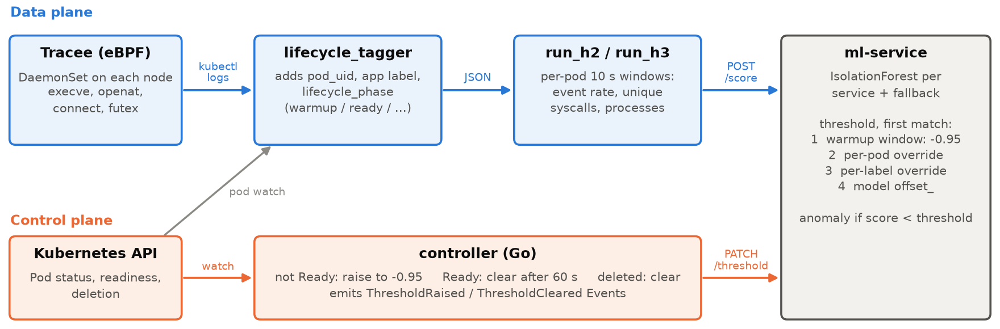
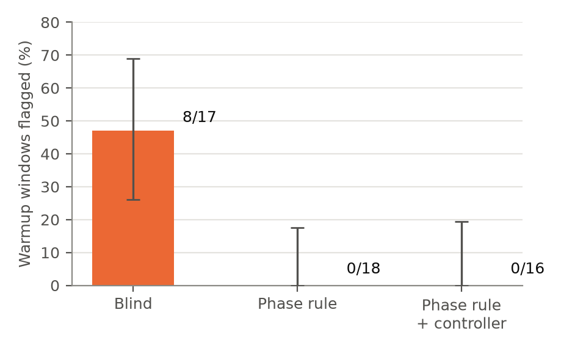
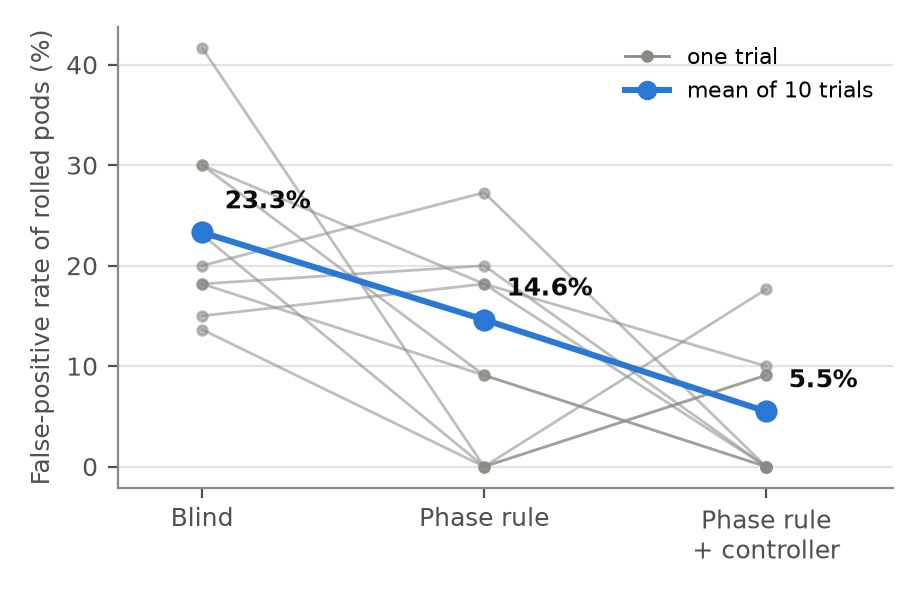
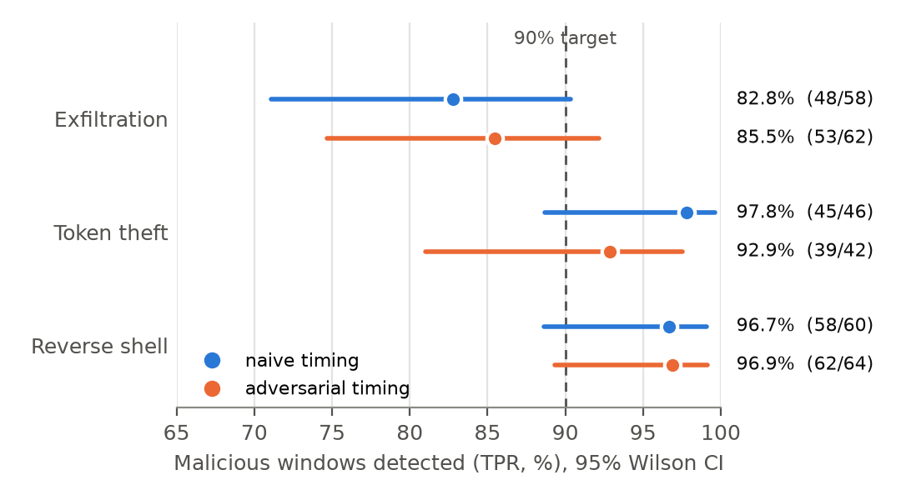

# Lifecycle-aware false-positive suppression for an eBPF ML IDS on Kubernetes

An eBPF intrusion detector that scores per-pod syscall behaviour with
IsolationForest flags many false positives while a rolling update is in
progress: a freshly started container behaves nothing like steady state. This
project adds Kubernetes lifecycle context to the detector:

- a **lifecycle tagger** stamps every Tracee event with its pod and lifecycle
  phase;
- the **ml-service** scores warmup windows against a looser threshold (the
  *phase rule*);
- a **Go controller** watches Pods and keeps the looser threshold for each new
  pod until 60 s after it becomes Ready.

It was evaluated on GKE with Google Online Boutique under load: false positives
during rollouts drop sharply, and three attack classes running alongside the
rollout are still detected. That holds even when the attacker times its attack
on the controller's public Kubernetes Events.

Built as part of my bachelor's thesis (Igor Sikorsky Kyiv Polytechnic Institute, 2026).



## Results

Two campaigns on GKE (3 × e2-standard-4, Tracee 0.24.1, Online Boutique,
Locust 50 users): 50 trials for false positives, 74 trials with 332 malicious
windows for detection. Full tables, tests and limitations are in
[docs/RESULTS.md](docs/RESULTS.md).

| Claim | Result |
|---|---|
| Rollouts cause false positives (no lifecycle context) | 8 of 17 warmup windows flagged (47%, 95% CI 26–69%) |
| The phase rule removes them | 0 of 18 (phase rule) and 0 of 16 (phase rule + controller) |
| Rolled-pod FPR, blind → phase rule → + controller | 23.30% → 14.63% → 5.49%; all four paired Wilcoxon tests reject H0 (Holm) |
| No over-suppression vs. the same-load steady baseline | +2.54 pp (95% CI +0.65 to +5.29), p = 0.0029 |
| Attacks still detected (TPR ≥ 90% not rejected) | 5 of 6 conditions; exfiltration with naive timing is borderline at 82.8% |
| Attacker timing on the controller's Events helps | no: naive vs. adversarial differences not significant in any attack class |

<p>



</p>

## How it works

| Component | What it does |
|---|---|
| [Tracee DaemonSet](k8s/tracee/daemonset.yaml) | eBPF events `execve, openat, connect, futex` from every container |
| [lifecycle_tagger.py](scripts/utils/lifecycle_tagger.py) | adds `pod_uid`, `app_label`, `lifecycle_phase` from a Pod watch |
| [run_h2.py / run_h3.py](scripts/experiments/) | per-pod 10 s windows → 3 features → `POST /score`, one CSV row per window |
| [ml-service](ml-service/) | IsolationForest per service + fallback; threshold = phase rule → per-pod override → per-label override → model `offset_` |
| [controller](controller/) | raises the per-pod threshold while a pod is not Ready, clears it 60 s after Ready, emits public Events |

Details and design decisions: [docs/architecture.md](docs/architecture.md).

## Reproduce

### Locally, from the published data (no cluster)

The raw per-window CSVs of both campaigns and the trained models are published
as a release asset (about 7 MB). Requires Python 3.12 and Go 1.25+.

```bash
python3 -m venv .venv && . .venv/bin/activate
pip install -r requirements-dev.txt
make data    # download, verify SHA-256, unpack into experiments/results/ and models/
make stats   # recompute every table and check it is identical to the shipped reports
make replay  # re-score all 30,591 windows with the published models; every score,
             # threshold and verdict must match the CSVs
make demo    # local ml-service + a synthetic rollout, phase rule off vs. on
make test    # Python tests (statistics, threshold precedence, API) and Go controller tests
make vet     # gofmt, go vet, go build
```

What each level shows:

| Check | Shows |
|---|---|
| `make stats` | the published tables follow from the published CSVs |
| `make replay` | the CSVs follow from the published models and the scoring code; each threshold is explained by the phase rule, the model `offset_` or the controller's hold |
| `make demo` | the mechanism end to end: the same warmup window is flagged without the phase rule and not flagged with it |
| `make test` | threshold precedence and TTL (stub model); controller state machine against a fake API server and a fake ml-service |

The eBPF capture itself needs a real cluster; local numbers would not be
comparable with GKE anyway (different kernel, event mix and load).

### A new campaign on GKE (costs money)

```bash
export PROJECT=<gcp-project>
make gke-up      # GKE cluster + kube-prometheus-stack
make build       # build and push both images to Artifact Registry
make deploy      # Tracee, ml-service, controller, Online Boutique
make train       # collect steady-state data and train the per-service models
make build deploy   # bake the new models into the ml-service image
N_TRIALS=10 CONDITIONS="BASELINE_IDLE BLIND_STEADY BLIND_ROLLOUT PHASE_ROLLOUT PHASECTRL_ROLLOUT" make campaign
make gke-down
```

Results from another cluster, kernel or GKE version will differ in detail;
the GKE version used for the published campaigns was not recorded.

## Repository layout

```
controller/        Go Pod reconciler
ml-service/        FastAPI scoring service
k8s/               manifests: Tracee, ml-service, controller, monitoring, attacker pods
scripts/infra/     GKE provisioning, image build, deployment
scripts/experiments/  training, campaign orchestrator, scoring drivers, attack injector
scripts/utils/     lifecycle tagger, statistics, resource profiler
analysis/reports/  formal Phase-1 tests (generated)
docs/              RESULTS.md, architecture.md, figures
```

## Limitations

Short version (full list in [docs/RESULTS.md §5](docs/RESULTS.md#5-limitations)):

- Few warmup windows (16–18 per condition): services become Ready within
  1–2 s, shorter than the 10 s scoring window.
- An attack *inside* a protected pod during warmup or the 60 s hold was not tested.
- With 4 syscalls the features are close to one-dimensional (about 99% of
  events are `futex`).
- The ml-service HTTP API has no authentication; restrict access to it outside
  a lab cluster.

## License

[MIT](LICENSE)
