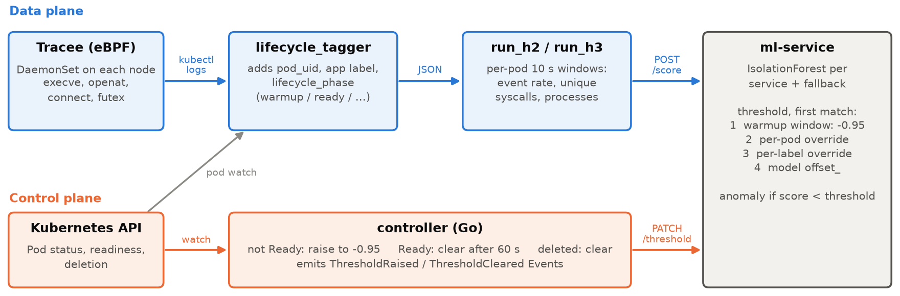

# Architecture

An eBPF + IsolationForest detector raises false positives when pods start:
a fresh container's syscall profile (image pull, init, readiness probes) looks
nothing like steady state. The system adds Kubernetes lifecycle context so
that warmup behaviour of a known-good rollout is not flagged, while everything
else is still scored normally.



## Data plane

```
Tracee DaemonSet ──kubectl logs──▶ lifecycle_tagger.py ──▶ run_h2.py / run_h3.py ──POST /score──▶ ml-service
 (eBPF, 4 syscalls)                 + pod_uid, app_label,     per-pod 10 s windows,              per-service
                                      lifecycle_phase          3 features                        IsolationForest
```

### Tracee (`k8s/tracee/daemonset.yaml`)
Aqua Tracee 0.24.1, `--scope=container`, events `execve, openat, connect,
futex`, JSON output. The event set is deliberately small: more frequent
events overflowed the `kubectl logs` pipeline.

### Lifecycle tagger (`scripts/utils/lifecycle_tagger.py`)
A stdin → stdout filter with a background Pod list+watch. For every event it
adds `pod_uid`, `pod_name`, `app_label` and `lifecycle_phase`:

| Pod state | `lifecycle_phase` |
|---|---|
| `deletionTimestamp` set | `terminating` |
| `Running` and every container Ready | `running_ready` |
| `Pending`, or `Running` but not every container Ready | `running_warmup` |
| anything else / pod not resolved | `unknown` |

Pods are resolved by Tracee's pod UID, then by (namespace, pod name), then by
container ID. The container-ID path matters for brand-new pods: Tracee fills
its `kubernetes.*` fields asynchronously, but the container ID is known from
the cgroup at once.

### Drivers (`scripts/experiments/run_h2.py`, `run_h3.py`)
- Admit only `running_warmup` / `running_ready` events from pods of
  deployments labelled `ids-research.io/protected=true` (`run_h3.py` also
  admits the attacker pod by name).
- Bucket events per `pod_uid` into 10 s windows by **receive time**. Tracee's
  kernel timestamps are not monotonic in the stream.
- Per window: `event_rate_per_sec`, `unique_syscalls_count`,
  `unique_processes_count` (plus `syscall_intensity_per_sec`, used only by an
  optional rule that is disabled).
- Window phase: `run_h2.py` labels a window warmup if it contains any warmup
  event; `run_h3.py` uses the last event's phase.
- POST each window to `/score` and write one CSV row (`# schema_version=…`
  header line, then the columns listed in `run_h2.py`).
- `run_h2.py` also writes per-POST telemetry and a validity verdict; a trial
  with more than 5% failed POSTs is re-run by the orchestrator.

### ml-service (`ml-service/`)
FastAPI, single worker (threshold state is in process memory).

- **Models.** One IsolationForest per Online Boutique service
  (`models/onlineboutique/<svc>.pkl`, selected by `app=<svc>`) and a fleet-pooled
  fallback (`models/baseline.pkl`) for services without a model and for pods
  without an `app` label. `contamination=0.05`, `n_estimators=200`,
  `random_state=42`; trained on steady-state (`running_ready`) windows.
- **Threshold selection** for a window, first match wins:
  1. `lifecycle_phase == running_warmup` and `apply_phase_authoritative` →
     **−0.95** (the phase rule);
  2. per-pod override set by the controller (`pod_uid`);
  3. per-label override (`namespace`, `label`);
  4. the model's own `offset_` (−0.544 to −0.641 for the trained models).
- **Verdict:** `score_samples(x) < threshold` → anomaly (lower = more anomalous).

| Endpoint | Purpose |
|---|---|
| `POST /score` | score one window; returns score, threshold used, verdict |
| `PATCH /threshold` | set (`value`) or clear (`value: null`) an override, with `ttl_seconds` |
| `GET /scores/recent` | recent scores (used only by the `--signal scores` injector mode) |
| `POST /admin/reload` | reload models from disk |
| `POST /admin/clear_thresholds` | drop all overrides (called before every trial) |
| `GET /health` | readiness |

Every override expires after its TTL even if nobody clears it.

## Control plane: the controller (`controller/`)

Go, controller-runtime v0.23.3. It watches Pods, acts only on pods matching
`--pod-selector` (`ids-research.io/protected=true`), and PATCHes `/threshold`
per `pod_uid`:

| Pod state | Action |
|---|---|
| `deletionTimestamp` set | clear the override now |
| every container Ready | clear the override **after `--warmup-ttl` (60 s)** |
| `Pending`, or `Running` and not Ready | raise to `--high-threshold` (−0.95), cancel any pending clear |

- Raises are sent with a server-side TTL of 5 × 60 s, so the TTL only matters
  if the controller dies.
- Each raise and clear also emits a public Kubernetes Event
  (`ThresholdRaised` / `ThresholdCleared`). The adversarial attacker in H3
  watches these.
- Metrics on `:9090`: `ids_controller_reconcile_latency_seconds` (time inside
  Reconcile, including the PATCH) and
  `ids_controller_e2e_ready_latency_seconds` (from the kubelet-stamped Ready
  transition, so it includes watch lag).

### Why both a phase rule and a controller
- **The phase rule** works on the phase stamped on the events, so warmup
  windows get −0.95 even if they reach the scorer late, after the pod is
  already Ready. Event delivery through `kubectl logs` lags pod-status changes.
- **The controller** covers what the phase rule cannot see. After a pod
  becomes Ready it keeps the high threshold for another 60 s, the settling
  period in which the new pod still behaves unusually. Measured effect: rolled-pod FPR
  14.63% (phase rule only) → 5.49% (phase rule + controller), see
  [RESULTS.md](RESULTS.md).

The cost: during warmup and the 60 s hold, an attack running *inside* the
protected pod would be scored against −0.95. This was not tested; the H3
attacks run in separate pods.

## Experiment conditions

`scripts/experiments/run_n10_cloud_trials.sh` runs every condition with the
same code and models; they differ in two switches.

| Condition | phase rule (`apply_phase_authoritative`) | controller replicas | rollout |
|---|---|---|---|
| `BLIND_STEADY` | off | 0 | no |
| `BLIND_ROLLOUT` | off | 0 | yes |
| `PHASE_ROLLOUT` | on | 0 | yes |
| `PHASECTRL_ROLLOUT` | on | 1 | yes |
| `BASELINE_IDLE` | on | 1 | no, Locust 1 user |
| `H3_<attack>_<NAIVE\|ADV>` | on | 1 | yes, plus attacker pod |

The rollout restarts `frontend`, `cartservice` and `productcatalogservice`.
NAIVE attacks are applied 30 s after the rollout starts. ADV attacks are timed
on the controller's `ThresholdRaised` Events by
`inject_attack_adversarial.py`.

## Design history

The first version keyed suppression by deployment (`namespace`, `app` label)
and summed all replicas into one feature vector. This made features depend
on the replica count, and one threshold covered old and new pods during a
rollout. The current design keys everything by `pod_uid` (per-pod windows,
per-pod overrides). The per-label override path is still in the ml-service
but is not used by the controller.

## Limitations of the design

- The −0.95 warmup threshold is absolute. A threshold relative to each
  model's `offset_` would be cleaner.
- Overrides live in ml-service memory; a restart drops them.
- The ml-service HTTP endpoints have no authentication. Outside a lab
  cluster, access to them should be restricted (for example with a
  NetworkPolicy that admits only the controller and the scoring drivers).
- `kubectl logs` as transport limits the event rate; a gRPC exporter
  (Tracee/Tetragon) would lift it.
